# Arsenal — StellarDrive mod

Firearms, explosives and ship weapons for **StellarDrive (Demo)**, made to look like the rest of the game (the models use the game's own hand-drawn atlas, colour palette and ink outlines). A MelonLoader mod, packaged for [Stellar Mod Manager](https://github.com/jollyname/StellarModManager).

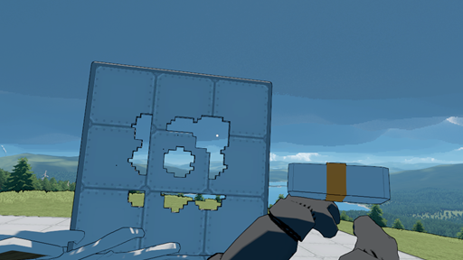

## Holes, penetration and breaking

Bullets and blasts damage hull panels for real:

- **Round holes.** A bullet drills a clean round hole, sized by its calibre; a blast tears a big round hole with ragged lobes, sized by how close it went off. Holes are cut into the game's own panel mesh (smooth outline, inner walls), so they keep the panel's colours and edges, and you can see — and shoot — through them. A hole on a seam carries on into the neighbouring panel instead of stopping in a half circle.
- **Penetration levels.** Every round has a penetration value and every material a resistance; a slanted panel counts as thicker. A round goes through when it has enough, loses that much and carries on to the next panel, so a weapon goes through a certain number of panels of each material. The armory shows it for each weapon ("Traverse : verre 4 · bois 1 · fer 0").
- **Materials behave differently.**

  | | Resistance | Holes | Notes |
  | --- | --- | --- | --- |
  | Glass | 4 | big, with a shattered rim | weak (40 HP), every hit counts in full |
  | Wood | 14 | a bit bigger than the calibre | soft, splinters; very shallow hits glance off |
  | Iron | 38 | clean, a bit smaller than the calibre | tough (460 HP); rounds without enough penetration only dent it, and shallow hits **ricochet** (the round skips off with a tracer and keeps half its punch) |

  | Weapon | Glass | Wood | Iron |
  | --- | --- | --- | --- |
  | SMG, PX-9, plasma shotgun | 1–2 | 0 | 0 |
  | Sidearm, laser minigun | 4 | 1 | 0 |
  | AR-47 | 9 | 3 | 1 |
  | Gauss revolver | 9 | 4 | 1 |
  | Anti-materiel rifle | 9 | 8 | 3 |
  | Heavy machine gun (ship) | 9 | 5 | 2 |
  | M-90 railgun / ship railgun | 9 | 9 | 8+ |

- **Breaking.** Every hit also wears the panel down. Once it has no strength left, or half of its area is gone, it breaks into the game's own debris.
- **Blasts push ships.** An explosion shoves every ship in reach away from it, from the side of the hull it hits — off-centre hits also set it spinning. The bigger the warhead (grenade < rocket < SAM < torpedo), the harder the push, so a rocket or missile hit visibly knocks an aircraft off its course.
- **Cinematic missile trails.** Rockets, missiles, SAMs and torpedoes leave a glowing exhaust core, a long vapour streak that stays visible from far away, and a thick trail of billowing smoke that hangs in the air for seconds. Bullet tracers are kept short and discreet.
- Damage is decided by the host and synced to every player, and it is **saved with the world** (`arsenal-damage.txt` next to `world.json`).

Every hull piece gets round holes and breaks — flat panels, wall and floor corners, slopes, slope corners and pivoted walls (their real outline is read from the game's meshes). A round that fits inside an existing hole passes through untouched; one that clips the rim bites into it and widens the hole, so firing at the same spot keeps chewing the piece. Doors take damage and break but keep no holes.

- **Blasts wreck machinery.** Missiles, rockets, torpedoes, grenades and charges also damage the parts bolted to a ship — thrusters, tanks, seats, batteries, consoles, chests, weapons... Each has hit points according to its size; a direct hit from a rocket or missile destroys what it hits, nearby parts are damaged and give way to the next blast, a torpedo clears a whole area. Destroyed parts disappear the way they do in crashes.

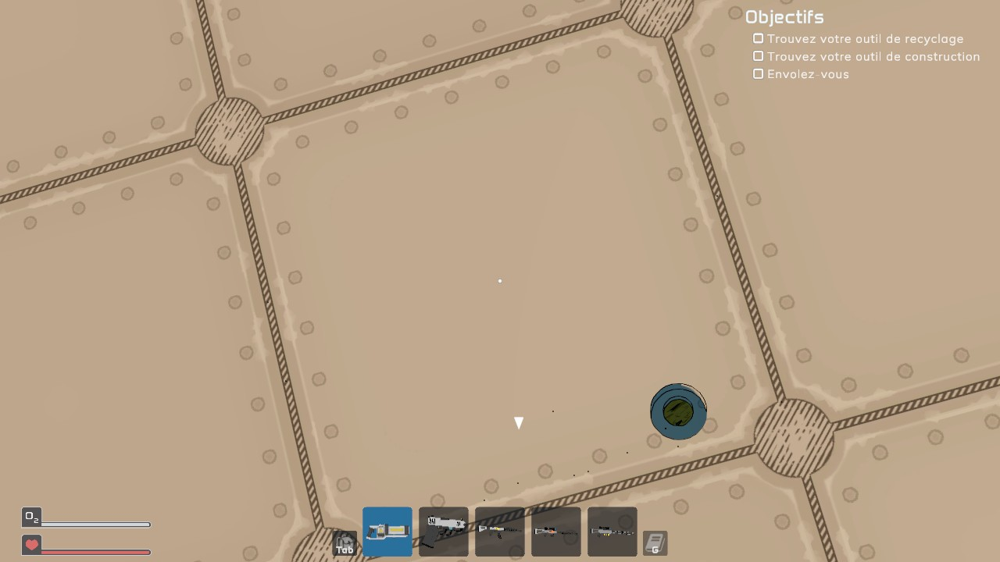
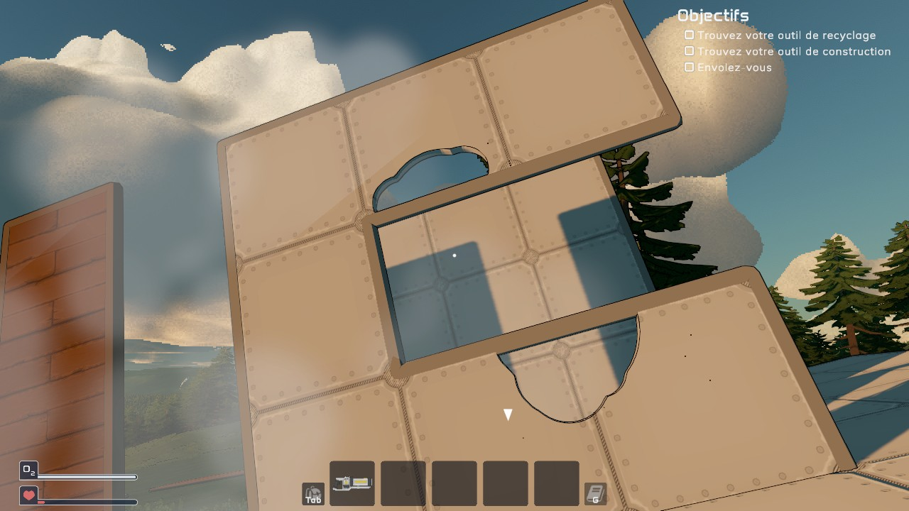

## Hand weapons

Use them like the game's tools (toolbar). Left click fires, **R** reloads, right click aims. The HUD at the bottom right shows the weapon, its rarity and its ammo, heat or charge.

| Weapon | Category | Fire |
| --- | --- | --- |
| Sidearm | sidearm | semi-auto, 12 rounds, goes through glass and wood |
| "Marshal" gauss revolver | sidearm | 6 heavy magnetic slugs, pierces iron |
| "Viper" SMG | sidearm | very fast full auto, 40 rounds |
| AR-47 assault rifle | rifle | full auto, 30 rounds, red-dot sight |
| "Vulcan" plasma shotgun | rifle | 8 burning plasma pellets |
| Anti-materiel rifle | rifle | bolt action, 5 rounds, scope, several iron plates |
| M-90 railgun | rifle | hold to charge, the slug goes through everything in line |
| "Cyclone" laser minigun | heavy | spins up, overheats |
| "Inferno" flamethrower | heavy | short cone of fire, sets players alight |
| PX-9 laser pistol | energy | rapid laser bolts, runs on heat (no reload) |
| "Blackout" EMP carbine | energy | ion bolts that jam weapons and knock ships out |
| "Tesla" arc | energy | electric arc jumping from target to target |
| "Néant" disintegrator | energy | continuous beam that ramps up and burns through walls |
| "Havoc" grenade launcher | explosive | lobbed grenades that blow on impact |
| "Titan" rocket launcher | explosive | accelerating rocket, big blast |
| "Eagle" SAM launcher | explosive | **locks on by itself** to the ship you point at (blips, then a steady tone and red brackets); the missile leads its target and has a proximity fuse |
| "Lightning" hypersonic launcher (legendary) | explosive | the shoulder-fired "Lightning": same automatic lock-on through a holographic sight, then a missile that accelerates up to 20,000 m/s and hits with an enormous blast |
| Grenade | explosive | left click throws (3 s fuse, bounces) |
| Breaching charge | explosive | left click sticks it to a surface, right click detonates all yours |

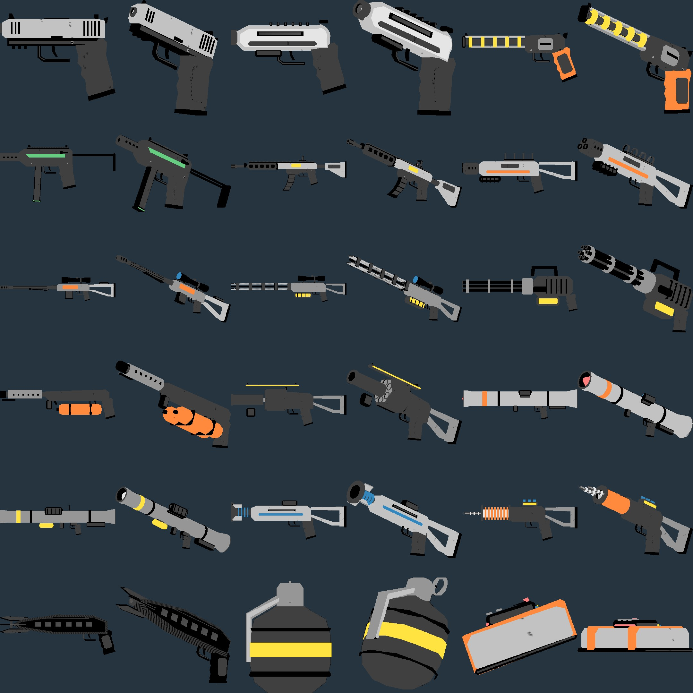
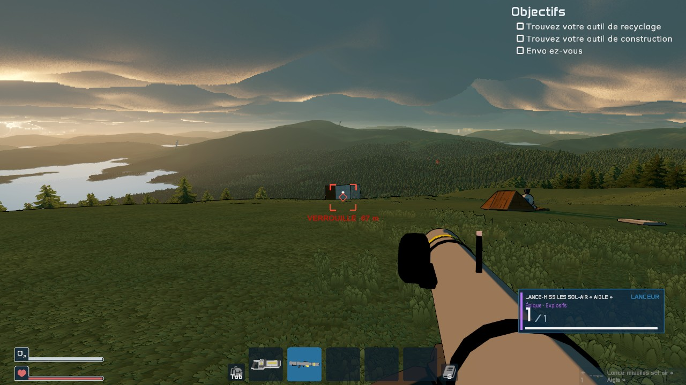
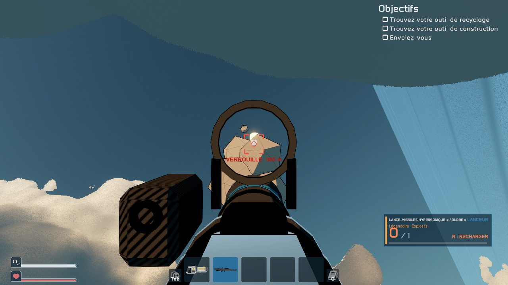
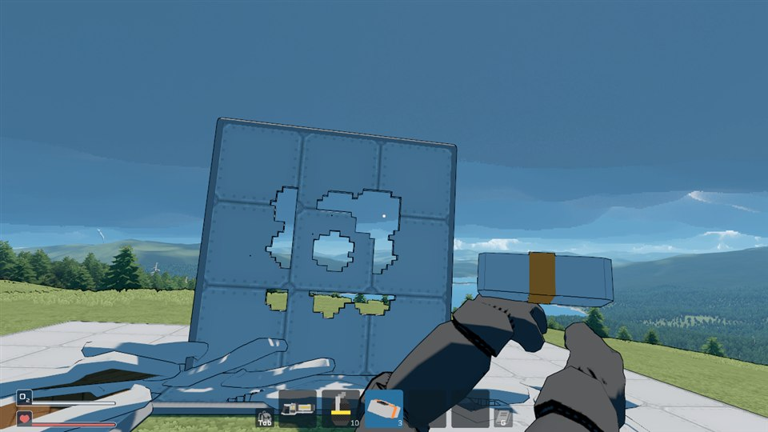
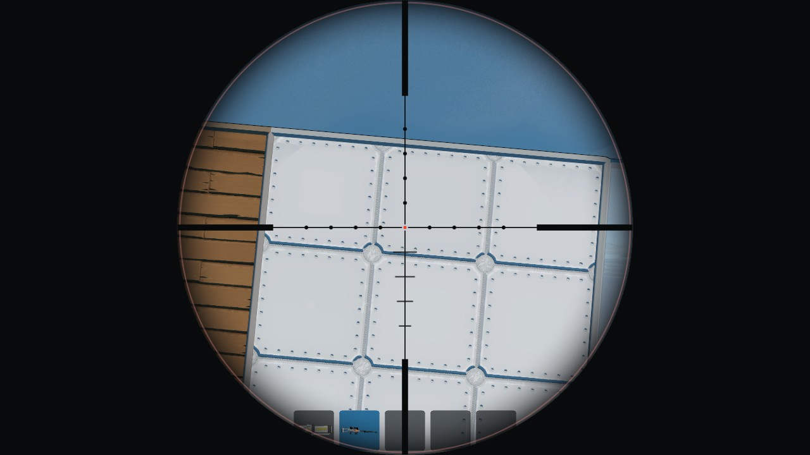
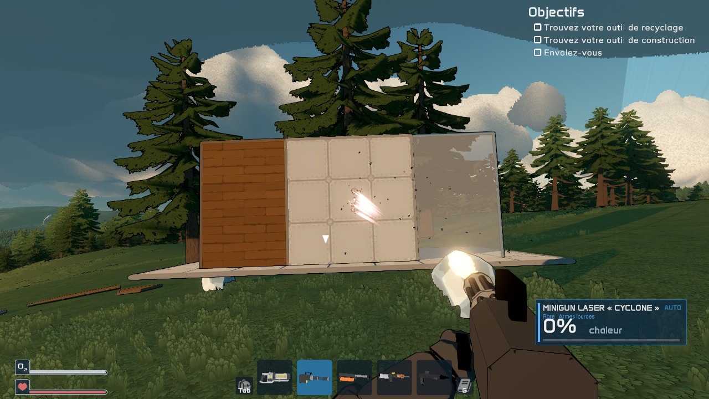
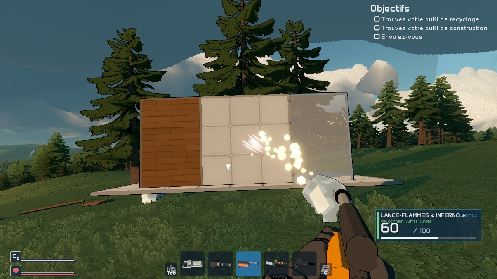
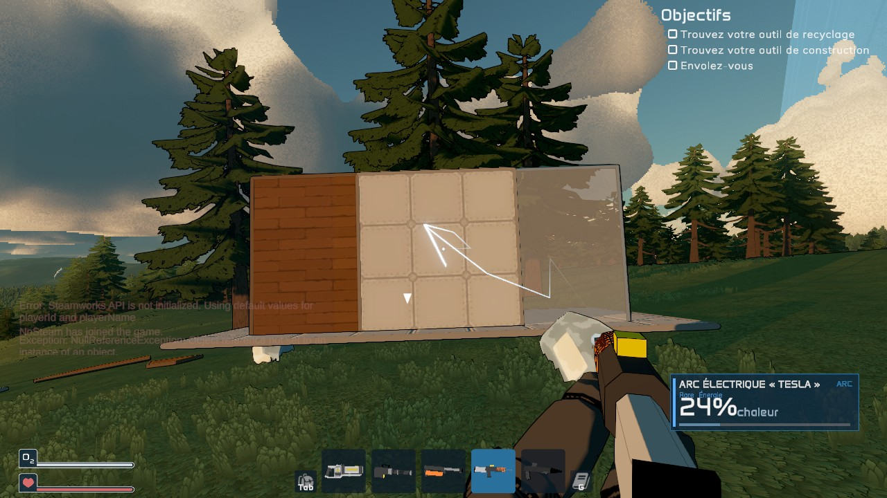
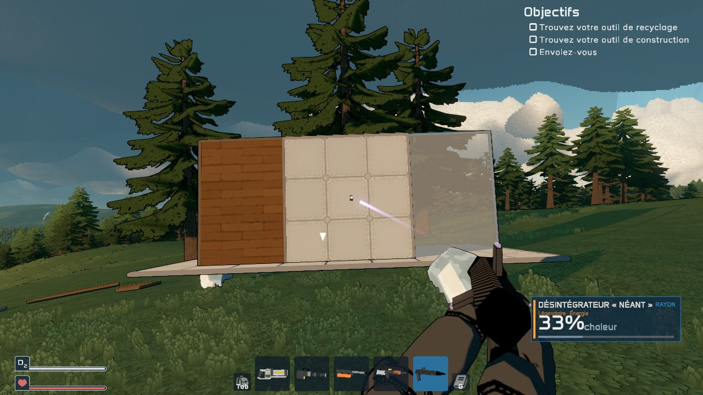

## Armory

Place an **Armory** (build menu, *Arsenal* tab) and open it like a chest: a fabrication terminal opens next to your inventory, built from the game's own menu pieces. Pick a category (sidearms, rifles, heavy, energy, explosives), see the weapon's rarity, description and stats, and **Fabricate** it from your materials (iron, copper, fuel…). The host checks the cost, takes the materials and puts the weapon in your inventory. The armory still works as a storage chest.

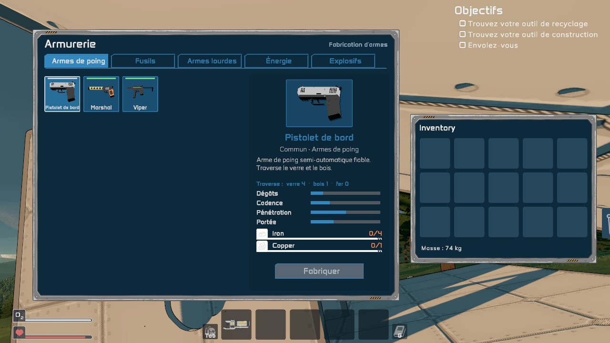

## PvP

Weapons hurt other players (headshots × 1.6). You get the feedback you expect from a shooter: hit markers (white, red for a headshot, with a tick sound), a red arc showing where damage comes from, a kill confirmation, a kill feed with the weapon used, and burn / jam overlays when you are on fire or hit by an EMP.

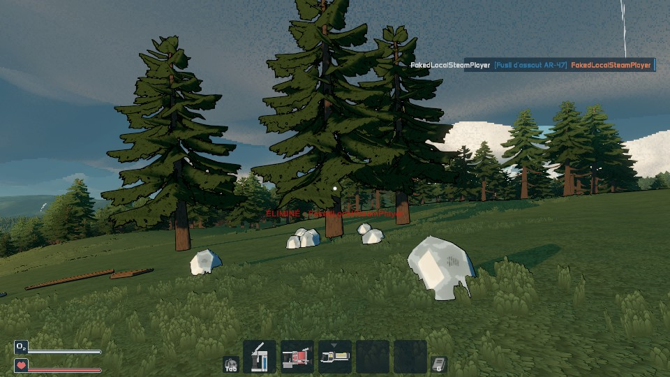
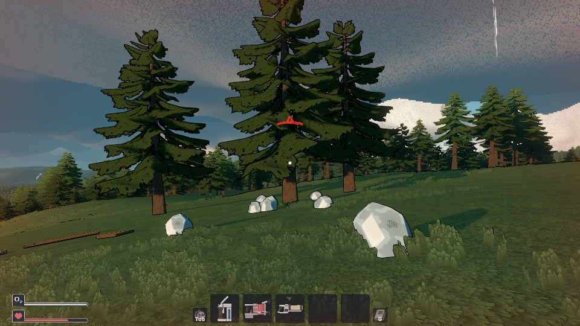

## Ship weapons

New tab **Arsenal** in the build menu, unlocked by three new technologies in the research tree: **Weaponry** (after *Powered Ship Controls*), **Heavy weaponry** and **Advanced weaponry**.

- **Gunner seat**: an advanced pilot seat with three more signal outputs that follow the pilot's buttons: *Fire 1* (left click), *Fire 2* (right click), *Fire 3* (middle click). Wire them with signal cables to the weapons — or to any logic, as with the game's other signals.
- **Heavy machine gun**: twin barrels, fires while its input signal is on, armour-piercing rounds.
- **Air-to-air missile pod**: locks the nearest ship in front of it, fires a homing missile on each signal pulse, 4 missiles that reload by themselves, proximity fuse.
- **Laser cannon**: a continuous beam that melts holes through hulls, overheats after a few seconds.
- **"Guardian" point defence**: a gatling turret that turns by itself and shoots down incoming missiles, rockets, torpedoes and plasma while its signal is on.
- **P-400 plasma cannon**: slow glowing plasma balls that explode on impact.
- **"Disruptor" ion cannon**: ion bolts that knock out the controls of the ship they hit for 8 seconds.
- **"Longinus" ship railgun**: charges for a second, then fires a slug that goes through several ships.
- **"Leviathan" torpedo tube**: locks a ship and launches a slow, homing, very heavy torpedo (15 s reload).
- **"Hail" rocket pod**: 9 unguided rockets fired in a salvo while the signal is on, full reload in 12 s.
- **"Falcon" SAM battery**: a radar turret that turns by itself towards the nearest **flying** ship, locks it automatically and fires a guided missile while its signal is on (4 missiles, reloads by itself). It only locks what its radar can actually see: a ship behind a hill, a ridge or another ship is ignored, and it holds fire while its launch path is blocked.
- **"Lightning" hypersonic missile launcher**: locks the nearest ship in front of it out to 8 km — even one flying far off in its own physics space — and fires a missile that accelerates at 6,000 m/s² up to 20,000 m/s. Proportional-navigation guidance and a proximity fuse checked along the whole path of each frame let it catch ships racing at 5,000–10,000 m/s, and its blast is pinned to the ship it hits so network lag can't make it miss. 2 missiles, 10 s reload.
- **"Swarm" flare dispenser**: throws a salvo of 6 burning heat flares on each signal pulse (4 salvos, reloads by itself). Every guided missile, SAM or torpedo that sees a hot flare may turn away and blow up on it instead of the ship.
- **Armory**: the weapon fabrication terminal (see above).

While you pilot, the HUD shows where each weapon points, the missile and torpedo lock, the laser heat, the railgun charge and what the point defence is tracking. A ship hit by an ion bolt or an EMP can't fly or shoot until it recovers.

**Radar warning**: when someone's lock-on (hand SAM launcher, SAM battery, missile pod, torpedo tube) sweeps your ship you hear a slow ping ("ENEMY RADAR"); once they are locked, a fast beep ("ENEMY LOCK"); and a guided missile coming at you sets off a two-tone alarm that speeds up as it closes in ("INCOMING MISSILE"), with markers around the screen centre showing where the threat comes from. Pop flares!

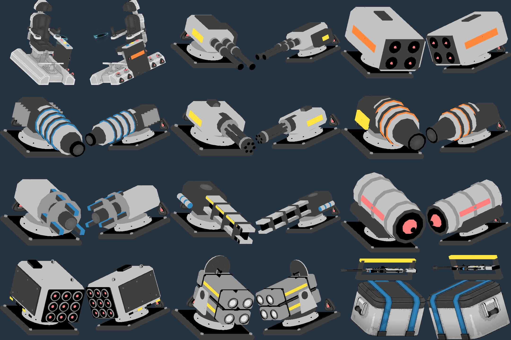
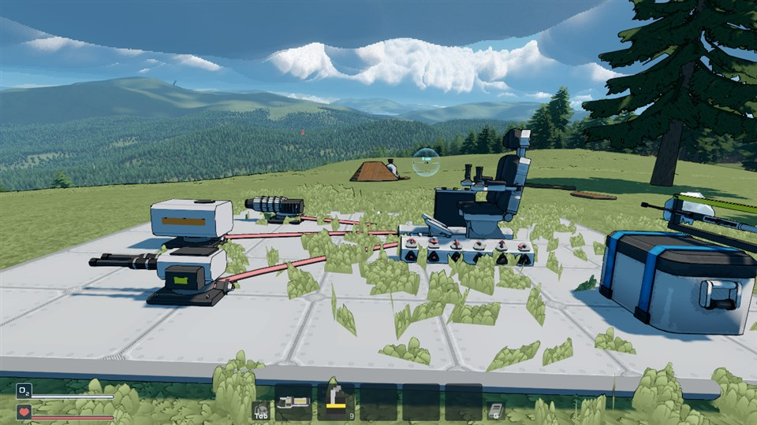
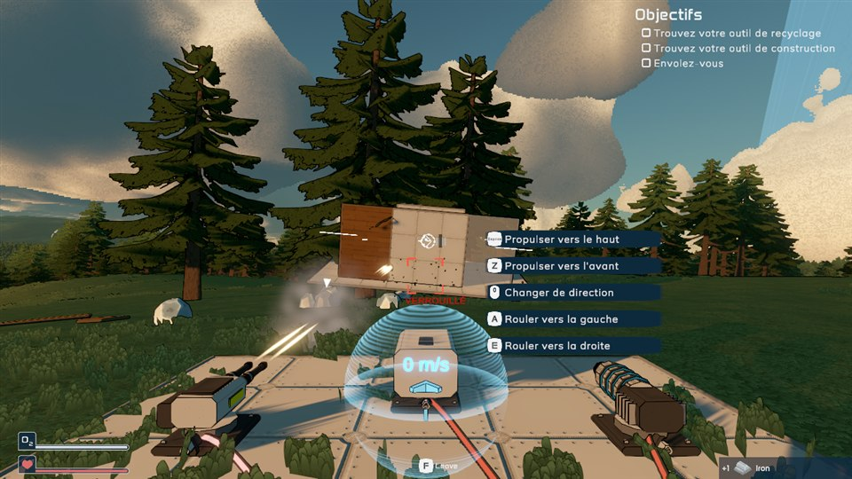
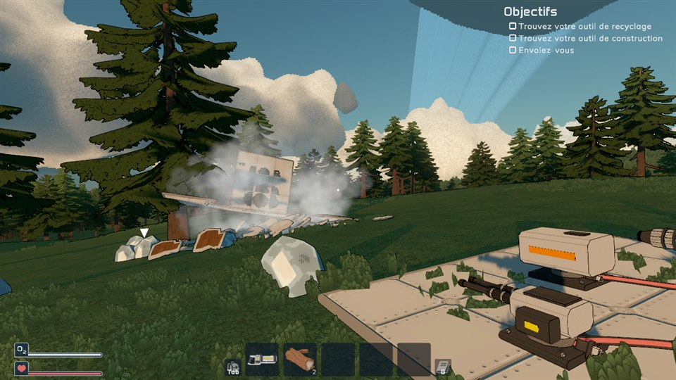
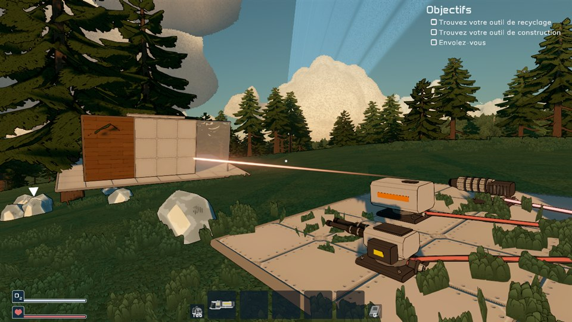
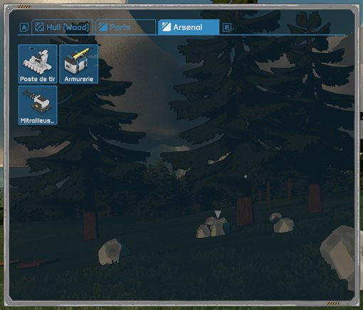
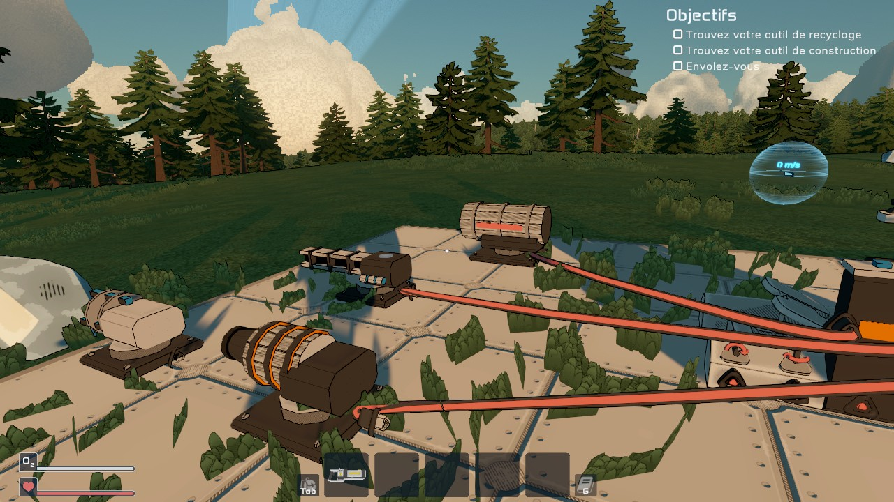
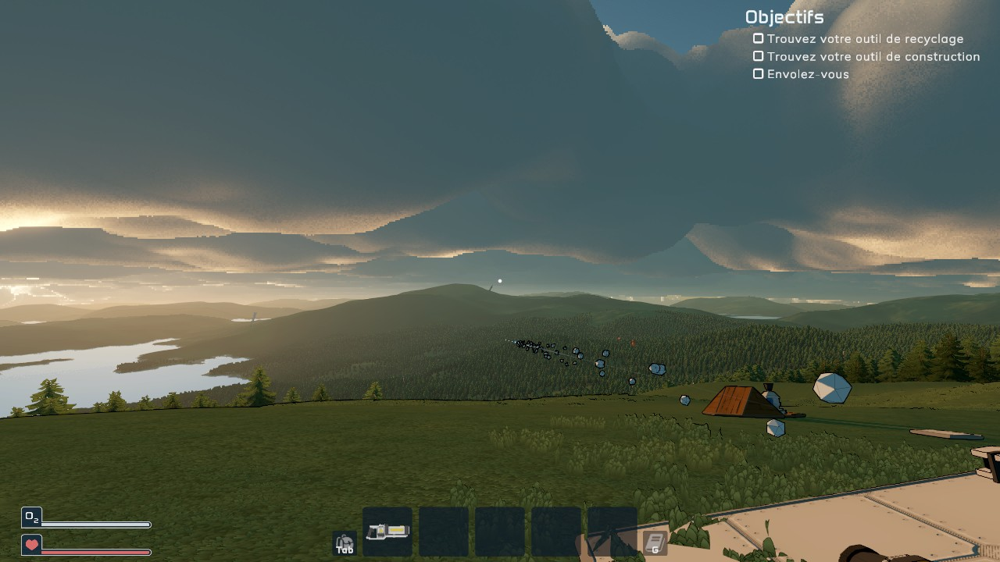
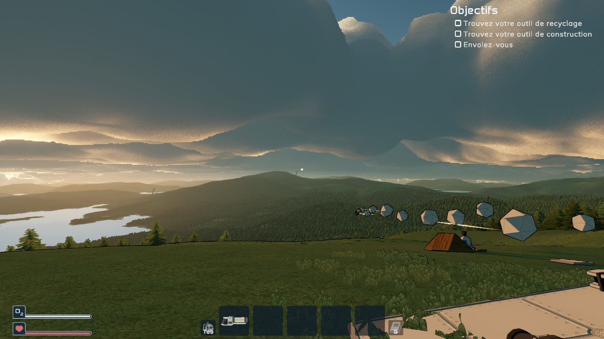

## Multiplayer

Works in multiplayer; **every player needs the mod** (the items, parts and research only exist with it). The player who fires does the aiming and hit detection, like the game's own tools; the host owns the damage (holes, health, explosions) and syncs it to everyone. Ship weapons are fired by whoever pilots that ship, or by the host when nobody does.

Targeting computers are cleared when the beacon they aim at is destroyed or its ship is wrecked, and a world saved with a target on a beacon that no longer exists is cleaned up when it loads (such a save used to crash the game).

## Settings

`UserData/MelonPreferences.cfg`, section `[Arsenal]`:

| Key | Default | Meaning |
| --- | --- | --- |
| `SoundVolume` | `1` | Weapon sound volume (0 = silent) |
| `GunnerFire1` | `<Mouse>/leftButton` | Input path for *Fire 1* in the gunner seat |
| `GunnerFire2` | `<Mouse>/rightButton` | Input path for *Fire 2* |
| `GunnerFire3` | `<Mouse>/middleButton` | Input path for *Fire 3* |

## Building

Needs the .NET SDK (6+), the game, and MelonLoader 0.7.x installed in the game folder (Stellar Mod Manager installs it for you).

```powershell
./build.ps1                                   # default Steam path
./build.ps1 -GamePath "D:\SteamLibrary\steamapps\common\StellarDrive Demo"
```

This produces `dist/StellarDrive-Arsenal.zip` in the layout Stellar Mod Manager expects:

```
mod.json
Mods/Arsenal.dll
```

### Dev build

`dotnet build src/Arsenal.csproj -c Release -p:DefineConstants=DEV` adds test tools that are never in the release build: the game loads the `ARS_Test` world on its own and runs commands written to `UserData/arsenal_cmd.txt` (`give`, `wall`, `range`, `gun`, `sit`, `shot`, …). `dev.sh` builds, installs and starts the game; `net.sh` starts a host and a client on the same PC to test multiplayer.

## Publishing to Stellar Mod Manager

1. Push this folder to a GitHub repo named `StellarDrive-Arsenal` (branch `main`), keeping `Mods/mod.json` and `Mods/Thumbnail.png`.
2. Create a release tagged `v1.6.1` (must match `version` in `mod.json`) and attach `StellarDrive-Arsenal.zip`.
3. Open a PR on [jollyname/StellarModRepository](https://github.com/jollyname/StellarModRepository) adding to `mods.json`:

```json
{ "author": "<your GitHub user>", "repo": "StellarDrive-Arsenal", "metadata": "Mods" }
```
